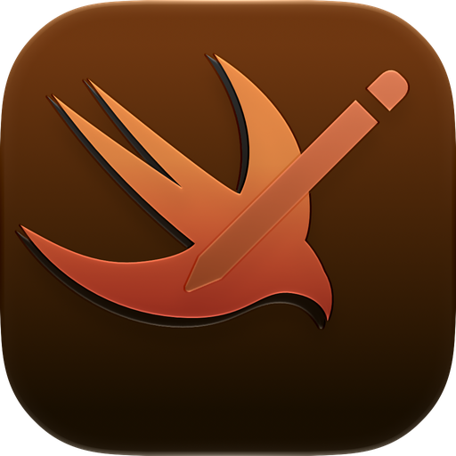

<p align="center">
  
</p>

<h1 align="center">SwiftNote</h1>

<p align="center">
  <strong>A lightweight macOS menu bar app for quick notes.<br>
  Write in live Markdown, dictate with your voice, and pin sticky notes to your desktop, all from one click.</strong>
</p>

<p align="center">
  <a href="https://github.com/TheShadowNinjaGMD/SwiftNote/releases/latest">📦 <strong>Download</strong></a> &nbsp;•&nbsp;
  <a href="https://swiftnote.base44.app">🌐 <strong>Official Website</strong></a> &nbsp;•&nbsp;
  <a href="https://theshadowninjagmd.github.io/SwiftNote/">📄 <strong>Project Page</strong></a> &nbsp;•&nbsp;
  <a href="https://github.com/TheShadowNinjaGMD/SwiftNote/issues">🐞 <strong>Report an Issue</strong></a>
</p>

---

> [!NOTE]
> **Works offline.** SwiftNote needs no internet connection to take notes. It only goes online to check for app updates and, if you choose, to download a Whisper dictation model.

## Contents

- [Features](#features)
- [Requirements](#requirements)
- [Installation](#installation)
- [Your data](#your-data)
- [Building from source](#building-from-source)
- [Issues and feedback](#issues-and-feedback)
- [Privacy](#privacy)
- [Disclaimer](#disclaimer)

## Features

- **Menu bar access:** open your notes with one click or a global shortcut, from any app.
- **Live Markdown:** bold, italics, underline, headings and lists render as you type.
- **Dictation:** use Apple speech recognition or local whisper.cpp models.
- **Desktop stickies:** pin any note to your desktop, then move and resize it.
- **Reminders and Calendar:** turn a note into a reminder or event.
- **Liquid Glass design:** adjustable glass opacity, custom accent colours and an optional accent tint.
- **Custom keybinds:** change every shortcut, or turn global keybinds off.
- **Backups:** notes autosave and are mirrored to a Desktop folder.
- **Automatic updates** via [Sparkle](https://sparkle-project.org).

## Requirements

- macOS 14 (Sonoma) or later

## Installation

### Option 1: Homebrew (recommended)

[Homebrew](https://brew.sh) is the package manager for macOS. If you already use it, this is the quickest way to install and update SwiftNote. Open **Terminal** and run the following. 

**1. Add the SwiftNote tap** (a tap is a small repository Homebrew reads to find the app):

```sh
brew tap TheShadowNinjaGMD/swiftnote
```

**2. Install the app:**

```sh
brew install --cask swiftnote
```

Prefer a single command? This taps and installs in one go:

```sh
brew install --cask TheShadowNinjaGMD/swiftnote/swiftnote
```

#### Managing SwiftNote with Homebrew

| Task                          | Command                                  |
| ----------------------------- | ---------------------------------------- |
| Update SwiftNote              | `brew upgrade --cask swiftnote`          |
| Uninstall                     | `brew uninstall --cask swiftnote`        |
| Uninstall and remove settings | `brew uninstall --zap --cask swiftnote`  |
| Remove the tap                | `brew untap TheShadowNinjaGMD/swiftnote` |

> [!NOTE]
> SwiftNote also updates itself with Sparkle, so `brew upgrade` is optional. Uninstalling never deletes your notes.

> [!TIP]
> If macOS shows an "unidentified developer" warning after a Homebrew install, follow the manual steps below to approve the app.

### Option 2: Manual

1. Download the `.dmg` from the [latest release](https://github.com/TheShadowNinjaGMD/SwiftNote/releases/latest) page.
2. Open the `.dmg` and drag **SwiftNote** into **Applications**.
3. Open SwiftNote. If macOS blocks it with a privacy warning:
   1. Go to **System Settings > Privacy & Security** and scroll down.
   2. Click **Open Anyway** next to SwiftNote.
   3. Open the app again and confirm.

## Your data

Notes are plain files stored on your Mac:

| Location                                   | Purpose                  |
| ------------------------------------------ | ------------------------ |
| `~/Library/Application Support/SwiftNote/` | Primary notes storage    |
| `~/Desktop/Swiftnote`                      | Automatic mirror (backup) |

## Building from source

Want to build it yourself? See [BUILDING.md](BUILDING.md).

## Issues and feedback

Found a bug or have an idea? [Open an issue on GitHub](https://github.com/TheShadowNinjaGMD/SwiftNote/issues).

## Privacy

We value your privacy. SwiftNote **does not collect, track, or transmit any user data**. Your notes stay on your computer. The only network activity is the update check and, if you choose, downloading a Whisper dictation model.

## Disclaimer

> [!IMPORTANT]
> **Independent open-source project.** SwiftNote is a free, community-built app provided as is, without warranty. Please keep your own backups of important notes.

All product names, logos and brands are the property of their respective owners.
