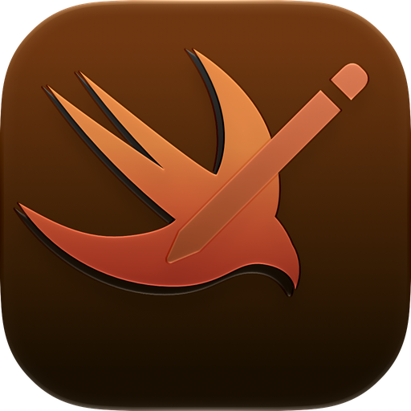

  

<h1 align="center">SwiftNote</h1>

  <strong>A lightweight macOS menu bar app for quick notes. Write in live Markdown, dictate with your voice, and pin sticky notes to your desktop, all from one click.</strong>

  <a href="https://swiftnote.base44.app"><strong>Visit Official Website »</strong></a>

***

> [!NOTE]
> **Works offline:** SwiftNote needs no internet connection to take notes. It only goes online to check for app updates and, if you choose, to download a Whisper dictation model.

## Features
- **Menu bar access:** open your notes with one click or a global shortcut, from any app.
- **Live Markdown:** bold, italics, underline, headings and lists render as you type.
- **Dictation:** Apple speech recognition or local whisper.cpp models.
- **Desktop stickies:** pin any note to your desktop, then move and resize it.
- **Reminders & Calendar:** turn a note into a reminder or event.
- **Liquid Glass design:** adjustable glass opacity, custom accent colours and an optional accent tint.
- **Custom keybinds:** change every shortcut, or turn global keybinds off.
- **Backups:** notes autosave and are mirrored to a Desktop folder.
- **Automatic updates** via Sparkle.

## Installation
1. Open the .dmg and drag SwiftNote to 'Applications'
2. If a privacy error occurs, follow these steps:
3. Go to Settings > Privacy & Security and scroll down
4. Click 'Open Anyway' next to SwiftNote
5. Open the app

Requires macOS 14 or later.

## Your data
Notes are plain files stored on your Mac:
- `~/Library/Application Support/SwiftNote/`
- `~/Desktop/Swiftnote` (mirror)

## Disclaimer

> [!IMPORTANT]
> **Independent open-source project:** SwiftNote is a free, community-built app provided as is, without warranty. Please keep your own backups of important notes.

All product names, logos and brands are the property of their respective owners.

### Privacy Policy
We value your privacy. This application **does not collect, track, or transmit any user data**. Your notes stay on your computer.

## Issues?
[Open an issue on GitHub](https://github.com/TheShadowNinjaGMD/SwiftNote/issues)

Want to build it yourself? See [BUILDING.md](BUILDING.md).
